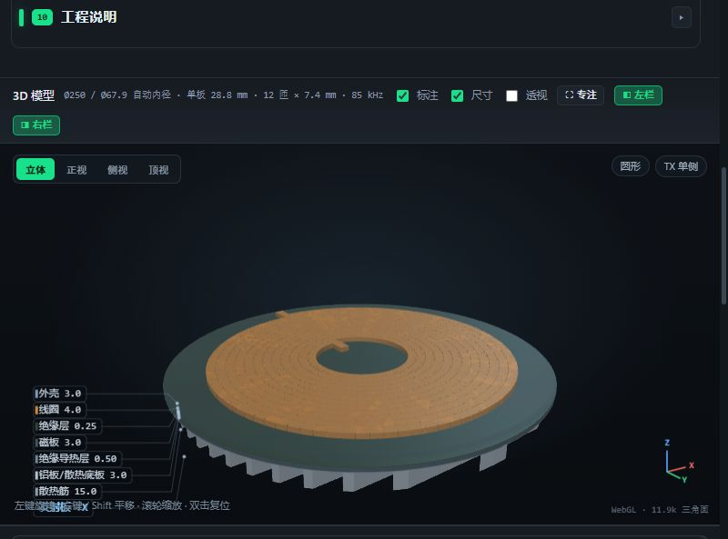

# WPT Pad Designer · 大功率无线充电线圈设计器

面向 AGV / 移动机器人等大功率无线充电场景的参数化线圈设计器：浏览器里完成几何、Litz、磁板、铝板、补偿拓扑与损耗筛查，并可调用本机 **ANSYS Electronics Desktop / Maxwell 2D & 3D** 做工程复核，最后导出多页 PDF 报告。

仓库地址：[GitHub](https://github.com/yzs00700/wpt-pad-designer) · [Gitee 镜像](https://gitee.com/hello-yong/wpt-pad-designer)

项目完成度与未测试/未开发清单：[PROJECT_STATUS.md](PROJECT_STATUS.md)



> 这是一个工程筛查与复核工具，不是第三方认证或最终签核。所有解析结果、2D/3D 有限元结果都应结合具体产品工况由工程师确认。

## 功能

- **功率范围 10 W – 10 kW**：滑块 + 可键入，内置常用功率档位；3 kW 默认失败点会明确提示是电压/母线边界，而不是 Litz 选型。
- **四种线圈形态**：圆形、方形、矩形、DD / DDQ / BP（DDQ / BP 的 3D 多线圈仍在开发）。
- **TX / RX 四种查看模式**：仅 TX、仅 RX、组合、对比；单侧视图自动隐藏 Z 间隙、总高、TX→RX 箭头与偏心/间隙标注。
- **连续平面螺旋 3D**：圆形/方形/矩形均为连续螺旋绕组，带引线、端部与圆角截面；不是同心圆示意。
- **Litz 与交流损耗**：股数/单丝直径、束径、匝距、Dowell 近似 Rac/Rdc、铜损/铝损/磁芯损耗筛查；5.6 另设每根引出线长度 L 和中心后出线/顶侧出线，长度进入 3D 引线修正。
- **候选搜索漏斗**：功率档 + 搜索范围 → 粗选约 10–20 组 → 精修 Top-3 邻域（OD ±25 mm、N ±1）→ 5 组候选。
- **磁板形态独立选择**：第 7 节拆成 7.1 材料 / 7.2 形态 / 7.3 拼装；支持整装/拼装、圆形/方形磁板，方形 R 角 0–宽度/2，外形随线圈自动生成也可手动修改；R 角自动同步到铝板/散热器、绝缘层、导热层、外壳和 2D/3D 外形；整装时 7.3 隐藏，等效 μr 直接取材料值。
- **3D 视图自动适配**：默认按当前视角把全部零件填满画布，不把机柜/边界框纳入取景；旋转、缩放、改窗口自动重算，不再需要每次手动放大。
- **仿真多视角图**：右侧 09 自动显示 3D 等轴测/正视/侧视/顶视 B 云图；Icepak 温度 PNG 可在同一区域导入查看。
- **自建样品 8.2**：右侧 08 增加两组实测线圈基准（Ls / DCR / Q / 3D 偏差），作为解析与仿真的可信度基线。
- **闪电电流特效**：TX/RX 两平面之间改为多股环形闪电电流，随 3D 模型一起旋转，不再使用三条粗波浪线。
- **安装开关**：第 4/6/7/8/9 节标题左侧有「安装」复选框；未安装层从 3D/2D/报告中消失，相关厚度与损耗按 0 处理。
- **ANSYS Maxwell 2D 工程签核**：严格网格、自适应求解、铜/铝损耗、磁密、场图、网格 CSV 与审计 ZIP。
- **ANSYS Maxwell 3D 复核**：实体螺旋绕组、整机/单侧模型、L/M/k、场图；单侧模型只建所选侧，M/k 返回空值。
- **仿真实时锁**：求解期间锁定所有参数输入，只保留「停止仿真」；停止或关闭页面会自动终止 worker 与 AEDT，避免残留进程。
- **多页 PDF 报告**：封面、摘要、参数、2D/3D 结果表、模型图、附 A（2D 原始图）、附 B（3D 原始图）；在新窗口/标签页打开，不破坏当前页面。
- **主题适配**：深色/浅色主题下 3D 标注、仿真进度层、图例均自动适配。

## 快速开始

### 环境

- Windows 10/11
- ANSYS Electronics Desktop **2025 R2**（含 Maxwell；PyAEDT 随 AEDT 自带）
- 浏览器：Chrome / Edge（WebGL 2）

> 没有 ANSYS 也能打开页面做解析筛查；连接求解、2D/3D 复核和审计产物需要本机 AEDT 与有效许可证。

### 启动

方式一（推荐，自动查找 AEDT 自带 Python）：

```powershell
.\start_bridge.ps1
```

方式二（手动指定 AEDT CPython）：

```powershell
& "D:\ANSYS2025R2\ANSYS Inc\v252\AnsysEM\commonfiles\CPython\3_10\winx64\Release\python\python.exe" wpt_bridge.py
```

然后打开：

```text
http://127.0.0.1:8765/
```

桥接同时提供：

- `GET /health`：空闲/忙碌状态
- `POST /solve`：2D Maxwell（独立 worker，可取消）
- `POST /solve3d`：3D Maxwell 后台任务
- `GET /artifacts/...`：审计图片与 ZIP

端口可通过参数修改：`wpt_bridge.py 8766` 或 `.\start_bridge.ps1 8766`。

## 多台电脑 / 网页编辑同步

发布到 GitHub 后，家里和公司电脑各 clone 一次：

```powershell
git clone https://github.com/yzs00700/wpt-pad-designer.git
cd wpt-pad-designer
```

以后改完代码，双击 `sync.bat`（或运行 `.\sync.ps1`）：

1. 自动 `git pull --rebase --autostash origin main`；
2. 自动提交本地改动（提交信息默认带时间和电脑名）；
3. 自动 `git push origin main`；如配置了 `gitee` remote，也会一起推送。

也可以直接在 GitHub 网页上编辑文件并提交；下次运行 `sync.bat` 会把网页上的修改拉到本地。

首次推送/拉取需要登录一次 GitHub：Windows 会弹出浏览器授权或用户名/Token 窗口，成功后由 Git Credential Manager 记住，之后不用重复输入。

如果两台电脑改了同一行，脚本会停在冲突状态，按 Git 提示解决后重新运行即可。

### Gitee 镜像（可选）

推荐把 GitHub 作为主仓库，Gitee 通过“导入仓库”或“仓库镜像管理”从 GitHub 自动拉取。这样日常只需要向 GitHub 推送，Gitee 会定时同步。

Gitee 空间地址是 [gitee.com/hello-yong](https://gitee.com/hello-yong)（显示名 `yzs00700`），与 GitHub 用户名不同，克隆 Gitee 时请使用 `https://gitee.com/hello-yong/wpt-pad-designer.git`。

## 目录结构

| 文件 | 说明 |
|---|---|
| `wpt-pad-designer.html` | 主页面（已内联视图模块，可直接打开） |
| `wpt-views-1.js` … `wpt-views-5.js` | 3D 场景、2D 截面/俯视、标注、图例等视图源码 |
| `build-views.ps1` | 合并视图模块并重新内联到主页面 |
| `sync.ps1` / `sync.bat` | 多台电脑一键同步：拉取 → 提交 → 推送 GitHub/Gitee |
| `wpt_bridge.py` | HTTP 桥、2D Maxwell、严格网格审计与产物打包 |
| `wpt_2d_worker.py` | 2D 求解子进程（取消时整树终止） |
| `wpt_bridge_3d.py` | 3D Maxwell 建模、求解、场图导出与自动适配视图 |
| `wpt_3d_worker.py` | 3D 求解子进程 |
| `wpt_regression.py` | 解析 vs 2D FEM 基线回归（`--rerun` 可重跑） |
| `wpt_3d_regression.py` | 3D 圆形/DD/方形/矩形回归（`--check` / `--run`） |
| `wpt_icepak_thermal.py` | Icepak 单侧半模型热筛查脚本（已跑通，未纳入签核） |
| `PROJECT_STATUS.md` | 完成度审计：已验证 / 未充分测试 / 未开发清单 |
| `COIL_MEASURED_ANALYSIS.md` | 两组小直径线圈的 DCR 反推、利兹线候选与设计器偏差 |
| `validation_coils_measured.json` | 两组线圈实测 LCR、几何、反推铜截面与利兹线候选 |
| `WPT_Designer_改进方案.md` | 设计取舍、建模口径与端到端实测记录 |
| `Litz_Maxwell_验证计划.md` | Litz / Maxwell 验证计划 |

## 已实测的基线

以下数值来自本机 AEDT 2025 R2 的端到端运行，仅代表测试工况（3 kW、85 kHz、30 mm 间隙、圆形 Ø250）：

| 项目 | 结果 |
|---|---|
| 2D 严格网格 | L 44.48 µH / M 30.37 µH / k 0.6829；铜损 14.24 W、铝损 4.91 W、Bmax 106.6 mT |
| 3D 组合 TX+RX | L 42.92 µH / M 31.00 µH / k 0.7221 |
| 3D 单侧 TX | L 32.92 µH；M/k 为空（单侧模型） |
| 3D 单侧 RX | L 33.13 µH；M/k 为空（单侧模型） |
| 3D 独立磁板形状 | 圆线圈+300×300 方板：组合 443 s，L 73.63 / M 54.56 / k 0.741；矩形线圈+Ø560 圆板：单侧 271 s，L 105.62 |
| 小线圈实测基线 | 线圈1 无磁板 31.368 µH / DCR 86.02 mΩ；线圈2 PC95 100×100×5 33.241 µH / DCR 51.94 mΩ；两支线成品 OD 1.65–1.8 mm，DCR=Rs/AC_DC 推算，按线圈1/2分别反推铜截面 1.02/1.26 mm²（130×0.1 / 160×0.1 仅为候选）；3D 自感线圈1 30.94 µH（−1.4%）、线圈2 含引线约 32.5 µH（−2.3%） |
| 2D vs 3D | L +3.6%、M −2.0%、k −5.4%（轴对称近似的已知偏差方向） |
| PDF | A4 14 页，附 A/附 B 各 4 张原图，无空白页；2D-only 报告明确标注未执行 3D |
| Icepak 单侧筛查 | 低/高损耗 33.5 / 35.7 °C（TX 单侧、半模型损耗、HTC 28.3 W/m²K；非签核） |
| 中止/关页 | 2D worker + AEDT 在约 1–3 s 内清理，桥接保持可用 |

回归检查：

```powershell
& "<AEDT Python>" wpt_regression.py
& "<AEDT Python>" wpt_3d_regression.py --check
```

## 已知限制

- **3D 磁板按整块建模**：磁板圆形/方形会按 7.2 重建，方形 R 角已进入 3D（竖边倒圆，R≥0.9×半宽时用圆柱近似）；但拼缝/分段仍未建，L 与 k 相对实际拼块磁板偏高；整装模式与 3D 整块模型最接近。3D 单线圈可用 `ferOn=0` 和 `lead_mm` 分离无磁板/引线影响。
- **DDQ / BP 的 Q 线圈与多线圈 3D 尚未实现**；页面会明确提示并拒绝把 2D 结果当作 3D。
- **3D 参数扫描 UI 尚未实现**，目前是单点复核；批量扫描用 `wpt_3d_sweep.py`。
- **Icepak 仅单侧半模型筛查**：求解器已修复并跑通（低/高损耗 33.5/35.7 °C），但未含 RX、外壳/散热筋、辐射与温度相关材料，不能作为热签核；页面温度仍为解析筛查值。
- **两支实测线按同一种线处理**：成品 OD 均 1.65–1.8 mm；表中 DCR 与 AC/DC 满足 `DCR=Rs/AC_DC`，DCR 不是独立四线测量，不能据此判定两种线规。130×0.1 / 160×0.1 只是股数候选，最终用四线 DC 或拆线确认。
- 2D 为轴对称单匝环等效，不含径向拼缝、实体绕组端部和引线；与 3D 的差异见上表。
- 3D 求解时间约 1–6 分钟，取决于网格、匝数与机器性能。

## 开发

修改 `wpt-views-*.js` 后重新生成内联页面：

```powershell
.\build-views.ps1
```

只改 `wpt-pad-designer.html` 中的样式/结构时无需重建，但请注意不要把内联模块覆盖掉。

## 许可证

本项目以 [MIT License](LICENSE) 开源。

ANSYS、Maxwell、Icepak、AEDT 是 Ansys, Inc. 的商标或注册商标。本仓库不包含 Ansys 软件或其许可证；使用本项目调用 AEDT 时需自行遵守 Ansys 的许可协议。
